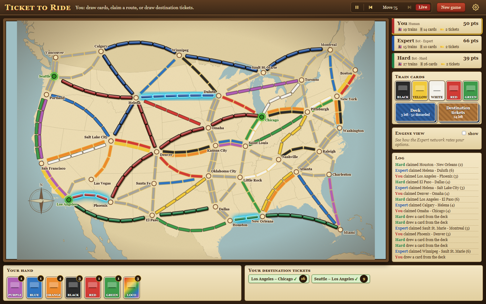

# Ticket to Ride AI

A playable version of the board game *Ticket to Ride* (USA map) that runs in your browser,
plus a set of computer opponents. The strongest of them taught themselves to play using
reinforcement learning (self-play) on an ordinary laptop CPU, with no GPU.



*A 3-player game in progress against the Expert (trained network) and Hard (hand-written)
bots. The sidebar shows scores, face-up cards and a move log, and your hand and tickets
are along the bottom.*

## What's in it

- **The full game, in the browser.** It has the 2015 rules for 2–5 players:
  - double routes close in 2–3 player games;
  - the Longest Route bonus;
  - the final-round trigger;
  - reshuffles.

  You can play against bots or pass-and-play, review a game move by move, and save and
  resume.
- **Mega Game mode.** It uses all destination tickets in one deck, with mode-specific
  point values and a +15 Globetrotter bonus for completing the most tickets. You're dealt
  5 tickets and keep at least 3; each later draw shows 4 and you keep at least 1.
- **Other boards.** Besides the USA map, the game can load boards you design yourself
  (see [Adding your own board](#adding-your-own-board)). Pick the board in the New game dialog.
- **Five bot levels:**

  | Level | How it plays |
  |---|---|
  | Easy | Plans routes for its tickets but keeps only the minimum and often draws cards at random |
  | Medium | Plans shortest paths for its tickets, collects matching cards, claims as it goes |
  | Hard | The competitive 2-player strategy: draws blind until it holds about 44 cards, then claims long routes every turn (beats Medium about 86% of the time) |
  | Expert | A neural network trained by self-play |
  | Master | The Expert plus look-ahead search at play time (wins about 3 games in 4 against the Expert alone) |

  Bots only use information a person at the table would have. For example, they remember
  which face-up cards each player took, but they can't see anyone's hand or tickets.
- **Engine view.** On your turn it shows the Expert's ranking of your options. *Simulate
  win %* plays out dozens of imagined games for each move, re-dealing everything you can't
  see.

## How the AI was trained

1. **Imitation.** A policy/value network first learned to copy the Hard bot.
2. **Self-play (PPO).** It then played about 900,000 games against a mix of opponents:
   - itself and older versions of itself;
   - earlier champions;
   - the rule-based bots, including a training-only "Blocker" that sees the network's
     tickets and claims the routes it needs.

   The reward is only the final result, so the network is free to find whatever plan
   actually wins. Training also includes deliberate experiments, such as unusual ticket
   choices, playing in a different style for a whole game, and trying a block. These keep
   it from settling on one strategy too early.
3. **Look-ahead targets.** Ticket choices, ticket draws and blocks are also learned by
   looking ahead: every option is tried and scored with the value network.
4. **Search at play time (Master).** The Master level samples possible hidden hands and
   tickets, plays out the network's top candidate moves several turns ahead, and keeps
   the move that scores best. Weak candidates are dropped early so a move takes at most
   about 3 seconds.
5. **A board-independent network.** A graph neural network passes messages between cities
   and routes, so it doesn't depend on this particular map. It's the first step toward a
   single model that handles new maps, ticket sets and player counts.
   - It was first distilled from the Expert.
   - It is now training on a mix of 2–5 player games and Mega Games.

### Results

Each figure is from 400 games on fresh deals, against Hard unless noted.

| Network | 2 players | Other |
|---|---|---|
| Expert (MLP, 1,312 inputs, 950 possible moves) | 75% | 77% vs Blocker; 65% vs an earlier Expert |
| Graph network (784k weights, still training) | 81.5% | 54% in the Mega Game; 11% in 4-player games vs three Hard bots, where 25% would be even |

Two strategy findings came out of the training:
- The network learned to value the Longest Route bonus only after explicit longest-path
  features were added. Before that, it rated the bonus at about +0.07 in win probability.
- The bonus actually decides about 30% of games against Hard.

## Run it yourself

You need Python 3.10 or newer.

```bash
git clone https://github.com/eang0521/ttr-ai.git
```

```bash
cd ttr-ai
```

```bash
pip install -r requirements.txt
```

```bash
python run.py
```

Your browser opens at http://127.0.0.1:8765. Click **New game**, choose the seats (you plus
any bots), and play:
- **Draw cards:** click the Deck or a face-up card.
- **Claim a route:** click it on the map. Routes you can afford pulse gold.
- **New tickets:** click **Destination tickets**.
- **Highlight a ticket's cities:** hover over the ticket.

On Windows you can also double-click `Play Ticket to Ride.bat`. Stop the game by closing
the console window or pressing Ctrl+C.

PyTorch's CPU-only build is enough, and much smaller to download:

```bash
pip install torch --index-url https://download.pytorch.org/whl/cpu
```

Run the tests with:

```bash
python -m unittest discover -s tests
```

## Project layout

| Path | What it is |
|---|---|
| `ttr/data.py` | Cities, the 100 routes, destination tickets, game modes |
| `ttr/engine.py` | Rules engine (headless and fast; used by the UI and by training) |
| `ttr/bots.py` | Rule-based bots and the difficulty levels |
| `ttr/planning.py` | Shortest-path ticket planning, used by the bots and as network inputs |
| `ttr/server.py`, `run.py` | Local web server |
| `web/` | Board UI (D3; map outlines from Natural Earth and US Census data via world-atlas and us-atlas) |
| `ttr/ai/encode.py` | Game position → network inputs; the action menu and legal-move mask |
| `ttr/ai/model.py` | Policy/value network and the Expert bot |
| `ttr/ai/imitate.py` | Stage 1: learn to copy the Hard bot |
| `ttr/ai/ppo.py` | Stage 2: self-play reinforcement learning (PPO with V-trace corrections) |
| `ttr/ai/search.py` | Play-time search (the Master level) |
| `ttr/ai/graph.py`, `ttr/ai/distill.py` | Graph neural network and distillation from the Expert |
| `ttr/ai/evaluate.py` | Win rate of a network against a bot or another network |
| `ttr/arena.py` | Bot-against-bot matches, e.g. `python -m ttr.arena hard medium --games 200` |
| `models/` | `expert.pt` (the game's Expert and Master) and `graph.pt` (the graph network) |
| `ttr/local_boards/` | Your own boards (not part of the repository; see below) |

Training checkpoints from earlier runs aren't included, to keep the download small. The
training commands are documented at the top of each file in `ttr/ai/`.

## Adding your own board

Put a Python file in `ttr/local_boards/`, for example `ttr/local_boards/my_town.py`. Git
ignores this folder, so a map of your own neighborhood stays on your computer. The file
lists the board in plain data:

```python
TITLE = "My Town"
SIZE = (2000, 1500)                      # drawing size; positions below use these units
CITIES = {"Library": (300, 400), "Park": (900, 350), "Station": (700, 1100)}
ROUTES = [                               # (city, city, length, color)
    ("Library", "Park", 4, "red"),
    ("Park", "Station", 5, ("blue", "gray")),  # two colors = a double route
    ("Library", "Station", 6, "gray"),         # gray = any one color
]
TICKETS = [("Library", "Station", 6)]    # (city, city, points)
```

Colors are the card colors: purple, white, blue, yellow, orange, black, red, green, or gray.
Optional settings, all described in `board_from_spec` in `ttr/data.py`:
- `TRAINS` (default 45);
- custom color names and fills;
- where each city's name sits;
- background parks and roads;
- hand-tuned route curves.

On any board you can play the Easy, Medium and Hard bots. The Expert and Master need a board
with exactly 36 cities and 100 routes (the USA board's size); there they play with the
board-independent graph network.

## License

The code is released under the [MIT License](LICENSE). The libraries and map data in
`web/vendor/` keep their own licenses: D3 and topojson-client (ISC), and world-atlas and
us-atlas (ISC, built from Natural Earth and US Census data).

The license covers this project's own code only, not the *Ticket to Ride* name or game
content.

## Disclaimer

This is an unofficial, non-commercial fan project made for learning about game AI. It is
not affiliated with or endorsed by Days of Wonder or Asmodee. *Ticket to Ride* is a
trademark of Days of Wonder, Inc. If you enjoy the game, please buy the real thing.
